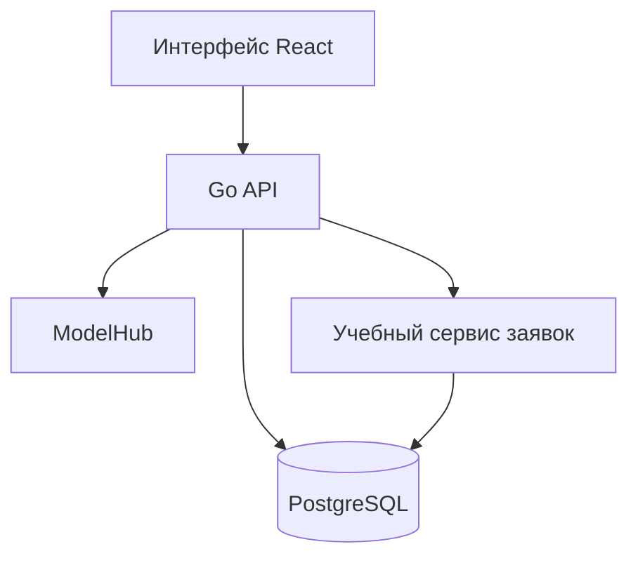

# Архитектура AI-buddy

AI-buddy помогает стажёру пройти путь от вопроса о доступе до открытия первой задачи. Прототип использует учебные команды Atlas и Orbit, синтетические правила и карточки по открытым источникам.

## Сессия, поиск и ответ

Go API определяет пользователя, команду и роли по серверной сессии. PostgreSQL фильтрует документы по правам перед отбором результатов поиска. В режиме с моделью API передаёт ей разрешённые фрагменты и сверяет предложенные источники и поля черновика с данными системы. При открытии источника права проверяются повторно. В учебном режиме API формирует ответ из того же каталога локально.

## Создание заявки

Стажёр проверяет черновик и подтверждает его версию. Сервер сохраняет операцию в PostgreSQL и выдаёт ей ключ идемпотентности. Воркер отправляет заявку через HTTP, сохраняет внешний номер и опрашивает статус. После таймаута воркер сверяет результат по тому же ключу. Учебный сервис сохраняет заявки в отдельной схеме и принимает решение оператора через отдельный маршрут.

Статус заявки определяет следующий шаг. Пока она согласуется, стажёр может изучить памятку по code review. После одобрения интерфейс открывает инструкцию первой задачи. Проверки подтверждения, прав и обработки сбоев описаны в [SDD](specs/README.md).

## Подключение к сервисам компании

Для пилота в одной команде гостевой вход заменяется корпоративной авторизацией, а HTTP-адаптер заявок — интеграцией с корпоративным API. Интеграция должна связывать запрос с пользователем, возвращать внешний номер и статус, поддерживать безопасную сверку после сбоя и учитывать назначение прав. Документы импортируются с реальными ACL команды. Сценарий проверяется сначала на тестовых аккаунтах и данных.

Для оценки пользы можно сравнить оформление заявки по инструкции и через AI-buddy. Измеряются время до готовой заявки, доля успешных прохождений без подсказок и количество обращений к наставнику.
